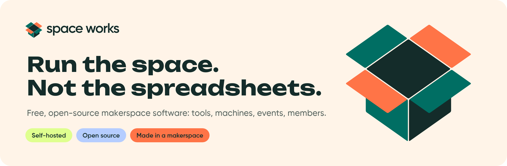

<picture>
  <source media="(prefers-color-scheme: dark)" srcset="https://raw.githubusercontent.com/SpaceWorks-Labs/.github/main/profile/assets/banner-dark.png">
  
</picture>

  <a href="https://spaceworks-labs.github.io/SpaceWorks-Labs-Website/"><b>Website</b></a> ·
  <a href="https://spaceworks-labs.github.io/SpaceWorks-Design-System/"><b>Design system</b></a> ·
  <a href="https://github.com/SpaceWorks-Labs/SpaceWorks#quick-start"><b>Get started</b></a>

# Built in a makerspace. Shared with everyone.

**Space Works builds free, open-source, self-hosted software for makerspaces, fab labs, tool libraries and the communities around them.** Track shared tools, run machines, host events, book rooms, manage memberships and give your team a place to work.

Start with the complete makerspace platform today; focused standalone apps for single jobs are on the way. Host it on your own infrastructure, keep control of your data, and adapt it to the way your community works.

## Why Space Works exists

> I'm [Shaan](https://github.com/Shaan-Shoukath), an electronics student who moved into software. Almost everything I know, I learned in a makerspace.
>
> I never had to buy every component and tool to learn hardware. I learned on the shared equipment at TinkerSpace by borrowing parts, breaking things and fixing them. The more I contributed, the more I was trusted with. I became its hardware and inventory manager, then a hardware mentor. Giving back to the space put me on stage as a speaker, made me a mentor at events, got me a seat as a hackathon judge, and led to my first internship. None of that came from a course or a résumé. It came from showing up, helping and sharing what I learned.
>
> Running the inventory also showed me the unglamorous side of keeping a space alive. Who borrowed the multimeter? Which 3D printer is free? When was the laser cutter last serviced? TinkerSpace already had systems for much of how it ran, but nothing for inventory and machines. That was the gap I lived in every day, so that's where Space Works started.
>
> Then I asked myself a bigger question: if I ever started a makerspace of my own, what would I want from day one? Events and registrations, bookable rooms, memberships, a place for the team to work. I kept adding them, one by one, until it covered the whole space.
>
> I've seen what a makerspace can do for people. It's where I got my chances: tools to learn on, the trust to take on more, a stage, mentoring and my first internship. I want more people to get that same start, and that means more spaces, run well.
>
> Everything in Space Works is something I learned by keeping a real space running. Building it is my way of passing that on, so the next person doesn't have to learn it all the hard way.
>
> Today almost anyone can build almost anything. If someone is inspired to start a makerspace, technology shouldn't be what holds them back, and makerspaces shouldn't be the last places to get good tech. So I set out to rebuild the whole makerspace toolkit as free, self-hostable software, so any space can have it from day one. If Space Works helps one more space open its doors, someone else gets the start I got.
>
> It's open source for the same reason makerspaces work: we share, remix and build on each other's work. Every space runs a little differently, so fork it, make it yours, and if you build something other spaces could use, send it back.
>
> A makerspace is a place to build together, so I didn't want to build this alone. I asked one of my closest friends, [Suraj Sunil](https://github.com/thisisonebit), to join me, and he designed the first Space Works brand guidelines, which shaped how everything looks today.
>
> — [Shaan](https://github.com/Shaan-Shoukath), who started Space Works at TinkerSpace Kochi

## SpaceWorks — the makerspace hub

[**SpaceWorks**](https://github.com/SpaceWorks-Labs/SpaceWorks) brings day-to-day makerspace operations into one modular, multi-tenant platform. One deployment can serve several spaces, each with its own members, inventory, roles and settings. Enable the modules your space needs.

**The hub brings inventory, lending, machines, events, bookings and membership management together in one installation.** The standalone apps below focus on those same areas for communities that only need one part. **Workspace is a separate internal team tool**, outside the hub's makerspace modules.

- **Inventory and lending:** public catalogues, borrow requests, QR checkout, photo-evidence handovers, returns and an audit trail.
- **Machines and making:** machine records, 3D-printing requests, service queues, consumables and maintenance.
- **Community:** events, registration, QR check-in, bookable spaces, memberships and maker profiles.
- **Operations:** optional payments, reports, notifications, backups and updates.

**Stack:** Python · Django 6 · Django REST Framework · React 19 · TypeScript · Vite · TanStack Query · Tailwind CSS · PostgreSQL · Redis · Celery · S3-compatible storage · Docker Compose.

[Explore the platform](https://github.com/SpaceWorks-Labs/SpaceWorks#readme) · [Browse its modules](https://github.com/SpaceWorks-Labs/SpaceWorks/blob/main/docs/MODULES.md) · [Install and self-host](https://github.com/SpaceWorks-Labs/SpaceWorks#quick-start)

## Standalone makerspace apps — on the way

Focused, standalone versions of the hub's main areas are being prepared for release: **Inventory** (stock room and lending desk), **Machines** (job requests, queues, maintenance and printer connections), **Events** (registration, QR tickets, check-in, badges and certificates), **Bookings** (rooms, studios, desks and halls) and **Organization** (memberships, renewals, payments and member cards). Each will be an independent app with its own backend, database and installation guide. Their repositories are private while they get ready; they will open here when they are released. Until then, the [SpaceWorks hub](https://github.com/SpaceWorks-Labs/SpaceWorks) covers all of these areas in one installation.

## Workspace — an internal tool for your team

[**SpaceWorks-Workspace**](https://github.com/SpaceWorks-Labs/SpaceWorks-Workspace) is the separate internal workspace for the people running a makerspace, community or organisation. It covers projects and kanban, chat, docs, files, finance, people, governance and an AI assistant with MCP. It runs independently alongside the makerspace hub or any standalone apps; its internal team features are not included in the hub.

**Stack:** TypeScript · Next.js 16 · React 19 · Prisma · PostgreSQL · Tailwind CSS · Radix UI · Redis · S3-compatible storage · Docker Compose.

## Native mobile clients

Take the SpaceWorks makerspace platform to the workshop floor. The native clients cover member and staff journeys, including equipment, requests, loans, bookings, events and QR/evidence workflows.

| Project | Stack | Platform |
| --- | --- | --- |
| [**SpaceWorks-iOS**](https://github.com/SpaceWorks-Labs/SpaceWorks-iOS) | Swift · SwiftUI · generated OpenAPI client · Xcode | iPhone and iPad, iOS 17+ |
| [**SpaceWorks-Android**](https://github.com/SpaceWorks-Labs/SpaceWorks-Android) | Kotlin · Jetpack Compose · Material 3 · generated OpenAPI client · Gradle | Android phones and tablets, Android 8+ |

Both clients can be configured for your own SpaceWorks backend. Live authentication, payments and push notifications depend on deployment setup; see each repository for current validation and release readiness.

## Shared foundations

| Project | What it holds | Stack / formats |
| --- | --- | --- |
| [**SpaceWorks-Design-System**](https://github.com/SpaceWorks-Labs/SpaceWorks-Design-System) | **Space Works Design System v2.0** — the shared base for every Space Works product: brand guidelines v2, logo masters and the animated box mark, Patch the mascot, icons, design tokens for light and dark, motion templates, UX specifications and product rules. [Browse the site](https://spaceworks-labs.github.io/SpaceWorks-Design-System/); reusable as a Git submodule. | SVG · CSS / JSON tokens · Astro Starlight |
| [**SpaceWorks-Labs-Website**](https://github.com/SpaceWorks-Labs/SpaceWorks-Labs-Website) | The public landing page introducing Space Works. | HTML · CSS · JavaScript · Python build script |

**Documentation lives in each repository.** The separate SpaceWorks-Docs site has been retired: installation, self-hosting, configuration, guides and API reference now sit inside the project they describe (its README and `docs/` folder), so they change in the same pull request as the code.

## Open source, under the AGPL

**Every public project here is open source and carries the GNU Affero General Public License v3**, and the standalone apps will be too when they are released. Most specify **AGPL-3.0-or-later**; each repository's license and notices define the applicable terms.

Use, study, modify and share the software, including for commercial work, under those terms. If you modify an AGPL application and let people use it over a network, offer those users the corresponding source for your modified version. Third-party dependencies, fonts and reference materials retain their own licenses.

Your community can run the software on its own infrastructure and contribute improvements back to the ecosystem.

## Build with us

Try an app, report a reproducible bug, improve a guide, translate a screen, or share a tested hardware integration. For code contributions:

1. **Fork the right repository.** Read its contributing guide, branch from the documented development branch, and keep your change focused on one issue.
2. **Keep the existing stack.** Follow the repository's languages, frameworks, architecture and design system. Discuss a new dependency or a stack change with maintainers before introducing it.
3. **Test the behavior.** Add meaningful tests for new behavior and a regression test for a bug fix. Cover relevant error cases, permissions and tenant isolation; use integration tests when a change crosses database or API boundaries.
4. **Run the repository's checks.** Run its documented tests, type checks, lint and build checks as applicable. Update documentation and API schemas when behavior or endpoints change, and keep secrets and personal data out of commits and test fixtures.
5. **Open a pull request from your fork.** Target the branch named in that repository's guide, link the issue, explain what changed and why, and include the checks you ran and their results. Add screenshots for UI changes and work through review feedback with the maintainers.

[Find an issue](https://github.com/search?q=org%3ASpaceWorks-Labs+is%3Aissue+is%3Aopen&type=issues) · [Contributing guide](https://github.com/SpaceWorks-Labs/.github/blob/main/CONTRIBUTING.md) · [Get help](https://github.com/SpaceWorks-Labs/.github/blob/main/SUPPORT.md) · [Report a security issue privately](https://github.com/SpaceWorks-Labs/.github/blob/main/SECURITY.md)

---

   
  Made with care by the Space Works community. Started by <a href="https://github.com/Shaan-Shoukath">Shaan-Shoukath</a> at TinkerSpace Kochi.

